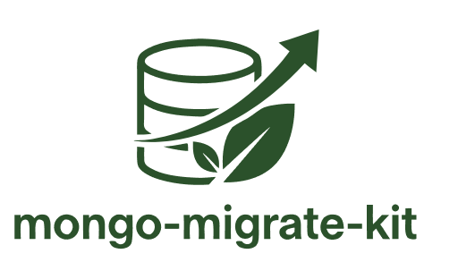

<div align="center">



# mongo-migrate-kit

**Elegant MongoDB migrations for Node.js.**

_Run a single file, roll back anything, and preview every change before it touches your database._

[](https://www.npmjs.com/package/mongo-migrate-kit)
[](https://mongo-migrate-kit.vercel.app/)
[](https://nodejs.org)
[](https://snyk.io/test/npm/mongo-migrate-kit)
[](https://opensource.org/licenses/MIT)

Single-file runs · rollback by batch, step or file · dry-run previews · transactions ·
lifecycle hooks · SHA-256 tamper detection · MongoDB-native locking · a history that's never
deleted. All in one small `mmk` CLI with a fully typed API.

**[📖 Documentation](https://mongo-migrate-kit.vercel.app/guide/)** ·
**[Quick start](https://mongo-migrate-kit.vercel.app/guide/getting-started)** ·
**[Why another migration tool?](https://mongo-migrate-kit.vercel.app/guide/why)**

<br>


<sub>A real session: preview, run, roll back one file, check the status.</sub>

</div>

---

You write small migration files with an `up` function (make a change) and a `down` function (undo
it). The `mmk` command runs them in order, records what ran in your database, and can roll back
exactly the one you mean: the last deploy, an older batch, the last few files, or a single file by
name.

## Reasons to choose it

Built for teams who outgrew the basics. You keep `up`, `down`, `create` and `status`, and gain:

- **Run a single migration** — `mmk up <file>`, not just "all pending".
- **Roll back anything** — a batch (`--batch 3`), the last N (`--steps 2`), one file, or `redo`.
- **Preview before you run** — `mmk dry-run up` prints the exact plan without touching the database.
- **No race conditions** — an atomic MongoDB lock stops two deploys running migrations at once.
- **Tamper detection** — SHA-256 checksums catch a migration edited after it was applied.
- **Audit trail kept** — a rollback updates the record, it never deletes it.
- **Lifecycle hooks** — `beforeAll`, `afterAll`, `beforeEach`, `afterEach`, `onError`.
- **Opt-in transactions** — wrap a migration so it fully commits or fully aborts.
- **TypeScript, ESM & CommonJS** — all run with no `ts-node` plumbing, and the package ships its
  own types ([TypeScript guide](https://mongo-migrate-kit.vercel.app/guide/typescript)).
- **Zero config files required** — drive everything from env vars if you prefer.

> [!TIP]
> ### 🔄 Already using `migrate-mongo`? Switch in under a minute.
>
> Point mmk at the same database and bring your whole history over. Nothing that already ran runs
> again, your old `changelog` is never modified, and you don't rewrite a single migration file.
>
> ```bash
> npx mmk import    # one time: copy your migrate-mongo history into mmk
> npx mmk up        # runs only what's new
> ```
>
> Your `up` / `down` / `create` / `status` habits carry over. You gain dry-runs, single-file runs
> and rollbacks, lifecycle hooks, and a lock that's on by default.
> **[See how it works ↓](#coming-from-migrate-mongo)**

## Quick start

```bash
npm install mongo-migrate-kit mongodb
```

```bash
npx mmk init                                  # writes mmk.config.js, set your uri and dbName there
npx mmk create add-users-email-index          # makes migrations/<timestamp>-add-users-email-index.js
```

Fill in the file (shown here as an ES module; in a CommonJS project mmk writes the same thing as
`module.exports = { … }`):

```js
export const description = 'Unique index on users.email';

export async function up({ db }) {
  await db.collection('users').createIndex({ email: 1 }, { unique: true });
}

export async function down({ db }) {
  await db.collection('users').dropIndex('email_1');
}
```

Then run it, look at it, and roll it back:

```text
$ npx mmk up
✔ Applied  20261015223650-add-users-email-index.js   [117ms]

$ npx mmk status
┌─────────────────────────────────────────┬─────────┬───────┬─────────────────────┬──────────┬──────────┐
│ Migration                               │ Status  │ Batch │ Applied At          │ Checksum │ Author   │
├─────────────────────────────────────────┼─────────┼───────┼─────────────────────┼──────────┼──────────┤
│ 20261015223650-add-users-email-index.js │ applied │ 1     │ 2026-10-15 22:36:51 │ ok       │ Asha Rao │
└─────────────────────────────────────────┴─────────┴───────┴─────────────────────┴──────────┴──────────┘

$ npx mmk down
↩ Reverted 20261015223650-add-users-email-index.js   [5ms]
```

No config file? `MMK_URI` and `MMK_DB` in your environment (or a `.env` file) are enough.

ES modules or CommonJS: the generated files match your `package.json` (`export` for
`"type": "module"`, `module.exports` otherwise), so they run without changes. See
[ES modules or CommonJS](https://mongo-migrate-kit.vercel.app/guide/writing-migrations#es-modules-or-commonjs).

**Next:** the [tutorial](https://mongo-migrate-kit.vercel.app/guide/tutorial) walks through a
realistic example in about 15 minutes.

## Learn it step by step

The docs are laid out as a path. Each step builds on the one before, and you can stop when you have
what you need.

| Step | Pages | Time |
| --- | --- | --- |
| 1. Get it running | [Quick start](https://mongo-migrate-kit.vercel.app/guide/getting-started), [Tutorial](https://mongo-migrate-kit.vercel.app/guide/tutorial) | 10 to 20 min |
| 2. Understand it | [How it works](https://mongo-migrate-kit.vercel.app/guide/concepts), [Writing migrations](https://mongo-migrate-kit.vercel.app/guide/writing-migrations), [A normal day with mmk](https://mongo-migrate-kit.vercel.app/guide/workflow) | 15 min |
| 3. Use it in production | [Configuration](https://mongo-migrate-kit.vercel.app/guide/configuration), [Deploying and CI](https://mongo-migrate-kit.vercel.app/guide/ci-cd), [Running from your code](https://mongo-migrate-kit.vercel.app/guide/api), [Transactions](https://mongo-migrate-kit.vercel.app/guide/transactions), [When something goes wrong](https://mongo-migrate-kit.vercel.app/guide/troubleshooting) | 30 min |
| 4. Bigger setups | [Sharing a database](https://mongo-migrate-kit.vercel.app/guide/shared-database), [Moving from migrate-mongo](https://mongo-migrate-kit.vercel.app/guide/migrate-mongo) | when needed |

Looking something up instead? [CLI cheatsheet](https://mongo-migrate-kit.vercel.app/reference/cli) ·
[Error codes](https://mongo-migrate-kit.vercel.app/reference/error-codes) ·
[FAQ](https://mongo-migrate-kit.vercel.app/guide/faq)

## How it compares to `migrate-mongo`

| Capability                                      | `migrate-mongo` | `mongo-migrate-kit` |
| ----------------------------------------------- | :-------------: | :-----------------: |
| Run a single migration file                     |        ❌        |          ✅          |
| Roll back a specific batch (not just the last)  |        ❌        |          ✅          |
| Roll back a single migration file               |        ❌        |          ✅          |
| Dry-run preview                                 |        ❌        |          ✅          |
| `redo` (down + up)                              |        ❌        |          ✅          |
| Concurrency lock on by default                  |        ❌        |          ✅          |
| Refuses to roll back an edited migration        |        ❌        |          ✅          |
| Lifecycle hooks                                 |        ❌        |          ✅          |
| History kept on rollback (never deleted)        |        ❌        |          ✅          |
| Adopt an existing `migrate-mongo` changelog     |        —        |          ✅          |

<sub>Reflects `migrate-mongo`'s documented CLI as of mid-2026. It also gives migrations transaction access
via a `client` argument; `mmk` exposes the same plus a declarative per-file `useTransaction` flag.</sub>

## Coming from migrate-mongo?

Point mmk at the same database and run `mmk import`. It copies your existing history into mmk's own
collection and never changes the old one. After that, `mmk up` only runs what's new.

```bash
npx mmk import --dry-run    # see what would be copied, write nothing
npx mmk import              # copy it
npx mmk up                  # runs only migrations migrate-mongo never ran
```


Imported migrations are forward-only, because migrate-mongo calls `up(db, client)` and mmk calls
`up({ db, client })`. New migrations roll back normally.
[The switching guide](https://mongo-migrate-kit.vercel.app/guide/migrate-mongo) has the details.

## Commands

| Command | What it does |
| --- | --- |
| [`mmk init`](https://mongo-migrate-kit.vercel.app/commands/create#mmk-init) | Create a commented config file |
| [`mmk create <name>`](https://mongo-migrate-kit.vercel.app/commands/create) | Create a migration file |
| [`mmk up [file]`](https://mongo-migrate-kit.vercel.app/commands/up) | Run pending migrations, or one file |
| [`mmk down [file]`](https://mongo-migrate-kit.vercel.app/commands/down) | Roll back the last batch, `--batch <n>`, `--steps <n>`, or one file |
| [`mmk redo [file]`](https://mongo-migrate-kit.vercel.app/commands/redo) | Roll back and run again |
| [`mmk status`](https://mongo-migrate-kit.vercel.app/commands/status) | Show every migration (`--check` exits 1 if any are pending) |
| [`mmk list`](https://mongo-migrate-kit.vercel.app/commands/status#mmk-list) | `--pending` or `--applied` only |
| [`mmk dry-run <up\|down>`](https://mongo-migrate-kit.vercel.app/commands/dry-run) | Show what would run, change nothing |
| [`mmk import`](https://mongo-migrate-kit.vercel.app/commands/import) | Copy a migrate-mongo history into mmk |
| [`mmk lock`](https://mongo-migrate-kit.vercel.app/commands/lock) | Show who holds the migration lock, change nothing |
| [`mmk unlock`](https://mongo-migrate-kit.vercel.app/commands/unlock) | Remove a lock left by a crashed run |
| [`mmk namespace adopt`](https://mongo-migrate-kit.vercel.app/commands/namespace) | For repos sharing a database: move older records into this repo's namespace |

Every command takes `--uri`, `--db`, `--dir` and `--config`. All the flags are on the
[CLI cheatsheet](https://mongo-migrate-kit.vercel.app/reference/cli).

## Running from your code

```ts
import { runMigrations } from 'mongo-migrate-kit';

// before the server starts listening
const { applied, upToDate } = await runMigrations(
  { uri: process.env.MONGO_URL!, dbName: 'shop' },
  { onLockHeld: 'wait' }, // other instances wait instead of failing
);
```

It opens its own connection and always closes it. If a migration fails, it throws, so your app
doesn't start on a half-migrated database. `pendingMigrations()` gives you a read-only list for
health checks. See [Running from your code](https://mongo-migrate-kit.vercel.app/guide/api).

## Configuration

Settings come from (highest wins) command-line flags, `MMK_*` environment variables, a
`mmk.config.js`/`.ts`/`.json` file, then defaults. Only `uri` and `dbName` are required.

```js
// mmk.config.js
export default {
  uri: process.env.MONGO_URL ?? 'mongodb://localhost:27017',
  dbName: 'shop',
  migrationsDir: './migrations',
};
```

The config can also be an async function, for loading the connection string from a secret manager
at runtime. All settings and environment variables are on the
[Configuration](https://mongo-migrate-kit.vercel.app/guide/configuration) page.

## Requirements

- Node.js 18 or newer. For `.ts` migrations or `mmk.config.ts` without a loader, Node 22.18 or
  newer (see the [TypeScript guide](https://mongo-migrate-kit.vercel.app/guide/typescript)).
- The `mongodb` driver, version 5 or newer (a peer dependency).
- MongoDB server 4.2 or newer. Transactions need a replica set or a sharded cluster.
- `mongoose` 7 or newer, only if your migrations use it.

## Contributing

Issues and pull requests are welcome. [ARCHITECTURE.md](./ARCHITECTURE.md) explains how the code is
put together and how to add a command. Ideas being explored (not promises) are in
[IDEAS.md](./IDEAS.md).

## License

[MIT](./LICENSE) © guptasantosh327
